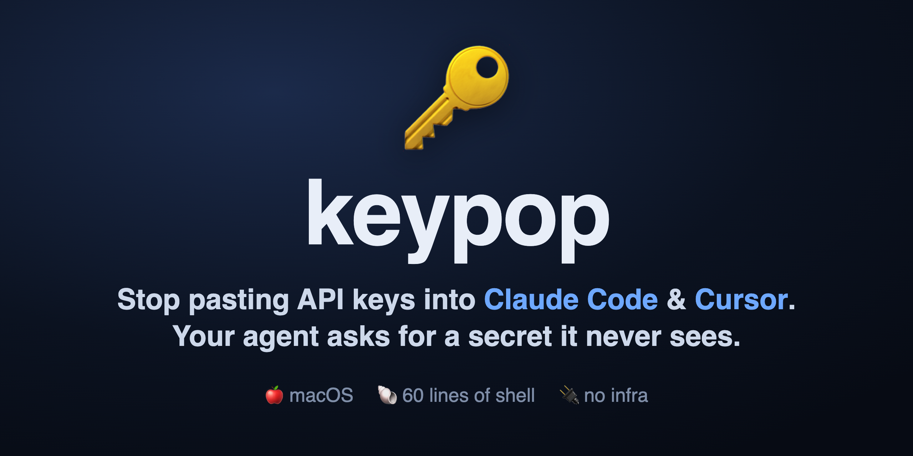

<p align="center"></p>

<h1 align="center">🔑 keypop</h1>

<p align="center"><b>Stop pasting API keys into Claude Code, Cursor, and other AI agents.</b><br>
keypop pops a native dialog so your agent collects a secret it never sees — the value goes to a local file, never the model's context.</p>

<p align="center">🍎 macOS · 🐚 60 lines of shell · 🔌 no infra, no daemon, no account</p>

<p align="center">
<a href="https://github.com/dylanpulver/keypop/actions/workflows/ci.yml"></a>
<a href="LICENSE"></a>
<a href="SECURITY.md"></a>
</p>

---

A secure secret-intake channel for AI coding agents (Claude Code, Cursor, etc.).

**The problem:** when an agent needs a credential, the obvious flow is "paste the key
into chat." That value then lives in your transcript history, in logs, and in the model's
context window — everywhere except where you want it.

**The fix:** the agent requests a secret *by name*; a native OS dialog collects the *value*
out-of-band; the value goes straight to a local, gitignored file. The secret never transits
the model's context.

```
agent  ──"I need OPENAI_API_KEY"──▶  keypop  ──▶  native macOS dialog (hidden input)
                                                       │  you paste, hit Save
                                                       ▼
                                             ~/.keypop/vault.env  (chmod 600)
```

The agent sees only the confirmation (`saved: OPENAI_API_KEY (164 chars)`) — never the value.

## Install

```bash
git clone https://github.com/<you>/keypop.git
ln -s "$PWD/keypop/keypop" /usr/local/bin/keypop   # or add to PATH
```

macOS only for now (uses `osascript`). Linux port via `zenity`/`kdialog` is a welcome PR.

## Usage

```bash
# one dialog per secret, each labeled with what's needed and why
keypop OPENAI_API_KEY:"for embeddings" SUPABASE_SECRET_KEY
```

- **Check-first:** a name the vault already has is skipped silently (no dialog) and reported as `already set`. keypop only pops a dialog for names it's missing, so re-running is safe and cheap. Pass `--force` to prompt and replace an existing value (rotating a key).
- **Save** (or Enter) writes the value to the vault.
- **Reveal / Hide** toggles masking in place — unmask to check a paste, re-mask when done. Masked by default.
- **Blank + Save** skips just this one.
- **Cancel all** (or Esc) stops the rest.

Output reports names and character counts only — never values:

```
saved: OPENAI_API_KEY (164 chars)
skipped: SUPABASE_SECRET_KEY
```

Change the vault location with `VAULT_FILE=/path/to/vault.env keypop ...`.

### Paste a whole block at once

Got several keys, or a `.env` snippet someone sent you? Skip the one-at-a-time dialogs:

```bash
keypop --paste
```

One dialog opens. Paste a block like:

```
OPENAI_API_KEY=sk-...
export SUPABASE_SECRET_KEY="ey..."
STRIPE_KEY=sk_live_...
```

keypop extracts every `NAME=value` line (handles `export`, quotes, and `=` inside values),
then shows a confirmation listing the **key names it found** — never the values — so a
misparse can't silently land in your vault. Confirm, and all of them save at once. The pasted
block never enters your shell history or the model's context.

Lines that aren't `NAME=value` (comments, prose, invalid names) are ignored.

### Working with project `.env` files

Import an existing `.env` you already have on disk straight into the vault:

```bash
keypop --import ./.env
```

It parses the file, skips any names the vault already has (so you don't clobber),
and shows a names-only confirmation before writing. Add `--force` to replace existing values.

Put a project `.env` "in play" while collecting keys:

```bash
keypop --env ./.env OPENAI_API_KEY STRIPE_KEY
```

With `--env`, a name already in that `.env` counts as set (no dialog), and every key you do
save is written to **both** the vault and that `.env` — so your app can read it at runtime
without you copying anything by hand.

## Reading secrets back

The vault is a plain `KEY=value` file, so consumption is boring on purpose:

```bash
# check before ever asking
grep -i openai ~/.keypop/vault.env

# load into a shell / project
set -a && source ~/.keypop/vault.env && set +a
```

## Wiring it into your agent

The script is only half the system. The other half is a short doctrine you paste into your
agent's instructions (`CLAUDE.md`, system prompt, rules file) so it *reaches for the popup
instead of asking for the value in chat.* See [`AGENT.md`](./AGENT.md) — copy it in verbatim.

## Why this is the right shape

- **The value never enters the model's context** — accountability for the secret stays with
  the human at the keyboard, not the transcript.
- **Requests are named and explained** — you approve `PROD_DB_PASSWORD:"for the migration"`,
  not an opaque prompt.
- **The vault is a dumb file** — no daemon, no service, no lock-in. `grep` it, `source` it,
  delete it.

## Security

keypop holds your credentials, so it's explicit about what it does and doesn't protect. Short
version: it keeps secret **values out of your agent's context**, but the vault is a plaintext
file guarded by filesystem permissions, not an encrypted secrets manager. Read
[SECURITY.md](./SECURITY.md) before trusting it with anything real — including one honest
disclosure about the Reveal toggle and `argv`.

## License

MIT — see [LICENSE](./LICENSE).
